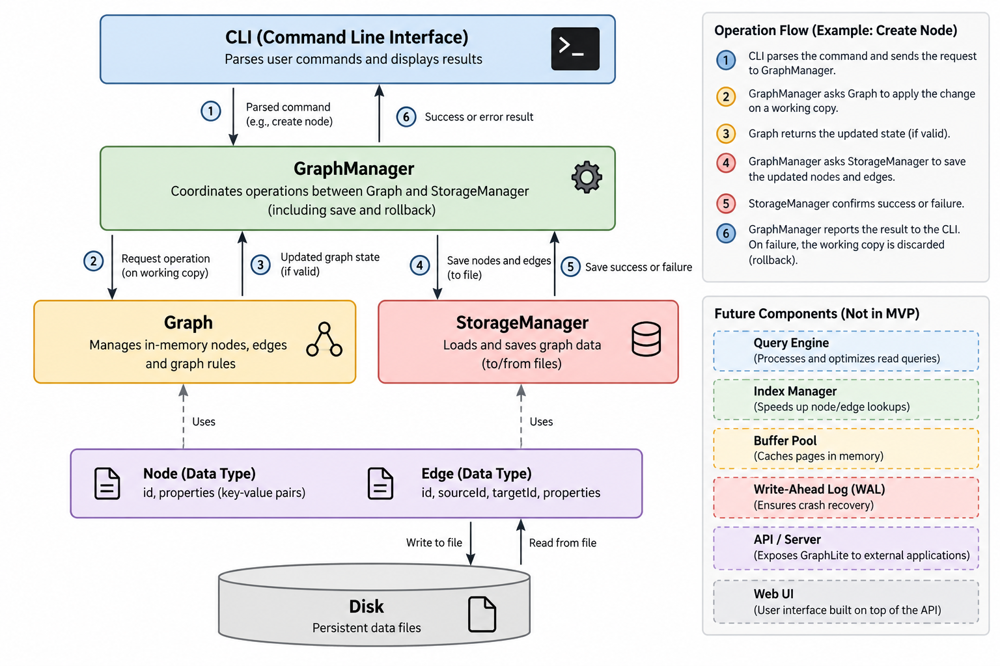

# GraphLite: System Design

## 1. Purpose and System Architecture

### 1.1 Purpose

GraphLite is a graph database engine written in C++17. It starts with a
small, working graph engine and will progressively grow toward
capabilities found in production graph databases such as JetBrains
YouTrackDB.

The initial implementation focuses on correctness and a working
end-to-end path: create and manage graph data, persist it, restart the
application, and retrieve the same data. More advanced database
internals will be added in later phases.

### 1.2 High-Level Architecture



The initial architecture contains the following components:

-   **CLI:** Reads commands and displays results.
-   **GraphManager:** Coordinates operations across the graph and
    storage components.
-   **Graph:** Owns and validates the in-memory graph.
-   **StorageManager:** Serializes, saves, and loads graph snapshots.
-   **Node and Edge:** Data types representing graph entities and
    relationships.
-   **Disk:** Stores the persisted graph representation.

### 1.3 Dependency Rules

-   The CLI communicates with GraphManager; it does not modify graph
    internals or access storage files directly.
-   GraphManager coordinates Graph and StorageManager.
-   Graph depends on graph data types and its own in-memory structures,
    not on StorageManager.
-   StorageManager depends on plain data types such as Node, Edge,
    PropertyValue, and GraphSnapshot. It does not depend on Graph.
-   Node and Edge represent data; they do not manage the graph
    collection or perform file I/O.

These boundaries keep graph rules, operation coordination, command
parsing, and persistence separate.

## 2. Technology Stack

- **Core engine:** C++17
- **Build system:** CMake
- **Initial interface:** Command-line interface (CLI)
- **Phase 1 persistence:** Custom versioned file format managed by StorageManager
- **Testing:** GoogleTest (planned for Milestone 0)
- **Version control:** Git and GitHub
- **Benchmark comparison:** MySQL (later phase)
- **Possible future frontend/API:** HTML, CSS, JavaScript and a C++ REST API (not part of Phase 1)

The core database engine remains in C++. Future tools are optional extensions,
not dependencies required to build the initial engine.

## 3. Data Model and Class Design

### 3.1 Node

A `Node` represents an entity in the graph, such as a person, movie,
product, or city.

**Fields**

- `id`: Unique unsigned 64-bit integer supplied by the caller.
- `properties`: Map of property names to typed values.

A node has no built-in label in the initial version. If needed, a type
such as `"User"` can be stored as an ordinary property.

**Responsibilities**

- Store the node ID and properties.
- Support reading, adding, updating, and removing properties.

A Node does not manage other nodes, edges, or file operations.

### 3.2 Edge

An `Edge` represents a directed, labelled relationship between two
nodes.

**Fields**

- `sourceNodeId`: ID of the starting node.
- `destinationId`: ID of the destination node.
- `label`: Relationship type, such as `FOLLOWS` or `LIKES`.
- `properties`: Map of property names to typed values.

An edge is identified by `(sourceNodeId, destinationId, label)`. The
initial version does not use a separate edge ID. These identity fields
are immutable; only edge properties can be updated.

Creating an edge from A to B does not create an edge from B to A.
Multiple edges between the same nodes are allowed when their labels
differ.

### 3.3 PropertyValue and Properties

A property value is one of the following types:

``` cpp
using NodeId = std::uint64_t;

using PropertyValue =
    std::variant<std::string, std::int64_t, double, bool>;
```

Node and edge properties are stored in a map keyed by property name.
This ensures each property name appears at most once per node or edge.

The supported property types are String, signed 64-bit Integer, Double,
and Boolean. Serialization must preserve each value's type.

### 3.4 Graph

`Graph` owns and manages the in-memory graph.

**Responsibilities**

- Create, retrieve, update, and delete nodes and edges.
- Enforce graph rules and invariants.
- Validate edge endpoints and duplicate relationships.
- Maintain incoming and outgoing adjacency structures.
- Retrieve incoming and outgoing relationships.
- Support bounded BFS traversal with an optional edge-label filter.
- Export graph data as a `GraphSnapshot`.
- Import a snapshot by rebuilding nodes first, then edges and adjacency maps.

Graph does not perform file I/O and does not depend on StorageManager.

### 3.5 GraphManager

`GraphManager` coordinates operations between the CLI, Graph, and
StorageManager.

**Responsibilities**

- Accept structured operation requests from the CLI.
- Coordinate graph operations and persistence.
- Return results or errors.
- Apply the shared mutation workflow so failed persistence does not change the active graph.

GraphManager does not parse raw command strings, implement detailed
graph rules, or perform file I/O directly.

### 3.6 StorageManager

`StorageManager` handles file-based persistence.

**Responsibilities**

- Save a `GraphSnapshot` to disk.
- Load and parse a saved snapshot.
- Validate the stored representation's format and structure.
- Return a specific storage, format, or parse error when an operation fails.

StorageManager works with plain data types and does not depend on Graph.

### 3.7 CLI

The CLI provides a text-based interface.

**Responsibilities**

- Delegate command parsing to `CommandParser`.
- Convert input into a structured `Command`.
- Call `GraphManager`.
- Display results and errors.

The CLI does not directly modify graph data or access storage files.

### 3.8 Label and Property-Name Rules

For Phase 1, edge labels and property names must be non-empty and contain only
ASCII letters, digits, and underscores. The first character must be a letter
or underscore. Spaces, quotes, punctuation, and empty names are rejected.
The same validation applies to CLI input and persisted data. Quoted strings
remain supported as property values.

## 4. In-Memory Data Structures

### 4.1 Node Storage

Nodes are stored by ID using a structure equivalent to:

``` cpp
std::unordered_map<NodeId, Node> nodes;
```

This supports average-case constant-time node lookup by ID.

### 4.2 Edge Storage and Identity

Edges are stored in an edge collection and indexed by their composite
identity:

`(sourceNodeId, destinationId, label)`

The implementation must ensure that an edge with the same identity
cannot be inserted twice.

### 4.3 Adjacency Structures

Graph maintains outgoing and incoming adjacency maps, conceptually:

``` cpp
std::unordered_map<NodeId, std::vector<EdgeKey>> outgoing;
std::unordered_map<NodeId, std::vector<EdgeKey>> incoming;
```

`EdgeKey` represents the composite edge identity. These structures help
Graph find a node's connected edges without scanning every edge.

When an edge is created or deleted, the edge collection and both
adjacency maps must be updated consistently. When a node is deleted, its
incoming and outgoing edges must be removed from all relevant
structures.

### 4.4 Future Indexing

The initial in-memory structures are not the final storage-engine
indexes. Later phases will add a node ID index mapping IDs to storage
locations, page-based adjacency storage, and optional secondary indexes
on properties.

Indexes improve lookup speed but require additional memory and
maintenance when data changes.

## 5. Storage and Persistence Design

### 5.1 Initial Persistence Strategy

Phase 1 uses whole-file persistence. After each successful mutation,
GraphLite saves the complete updated graph state before reporting
success.

StorageManager operates on a plain `GraphSnapshot`, not directly on
Graph. A snapshot contains collections of all nodes and edges. In-memory
adjacency maps are reconstructed when a snapshot is imported.

### 5.2 Save and Rollback Mechanism

GraphManager uses a copy-and-swap workflow for mutations:

1.  Create a working copy of the active Graph.
2.  Apply the requested mutation to the working copy.
3.  Validate the resulting graph state.
4.  Export the working copy as a GraphSnapshot.
5.  Ask StorageManager to save the snapshot.
6.  If saving succeeds, replace the active Graph with the working copy
    and report success.
7.  If saving fails, discard the working copy, retain the active Graph,
    and return `StorageError`.

The active graph is not changed until persistence succeeds. The working
copy must include all graph data and adjacency structures so that they
remain consistent.

All mutating operations use this shared workflow. Operation-specific
validation happens before the save step.

StorageManager writes the new representation to a temporary file and
replaces the previous saved file only after the new file has been
written successfully. This reduces the risk of losing the last valid
saved state, but does not by itself guarantee durability against every
crash.

### 5.3 File Format

The initial format is versioned, human-readable text. It contains:

- A format identifier and version.
- Node records with IDs and properties.
- Edge records with source IDs, destination IDs, labels, and properties.
- Explicit type tags for property values.

Conceptual example:

``` text
GRAPHLITE 1
NODE 101
PROP name STRING "Alice"
PROP age INT 25
END_NODE
NODE 102
PROP name STRING "Bob"
END_NODE
EDGE 101 102 FOLLOWS
END_EDGE
```

The implementation must define escaping for strings, record boundaries,
whitespace handling, and validation rules so that all supported values
can be represented unambiguously. The example illustrates the structure;
it is not a complete parser specification.

### 5.4 Loading and Corrupt Files

StorageManager reads and parses the file into temporary data before
returning a snapshot.

-   The format identifier and version must be recognized.
-   Records and property types must be valid.
-   Duplicate node IDs and duplicate edge identities must be rejected.
-   Every edge endpoint must refer to an existing node.
-   A file with malformed records returns `ParseError`; an unsupported format or version returns `InvalidFormat`; file-system read/write failures return `StorageError`.
-   A failed load must not leave a partially constructed graph active.

GraphManager imports the snapshot only after loading and validation
succeed.

### 5.5 Known Limitations and Future Improvements

Phase 1 has the following limitations:

- Every mutation rewrites the whole file, making persistence O(n) in the amount of stored graph data.
- No explicit `fsync`-based durability guarantee is provided.
- A process or machine crash may lose recent changes or affect the saved file.
- The initial implementation is single-threaded.
- Copying the graph for every mutation adds memory and runtime overhead.

Later phases will introduce fixed-size pages, page management, a node ID
index, a buffer pool, write-ahead logging, and crash recovery.

### 5.6 Startup and Load-Failure Policy

- If the configured database file does not exist, GraphLite treats this as a first run and starts with an empty graph. This is not a storage error.
- If an existing file cannot be read, parsed, or validated, startup fails and GraphLite reports the specific error. It must not silently continue with an empty graph.
- Until recovery tooling exists, a failed load prevents mutations and therefore prevents overwriting the existing file.
- Snapshot loading validates the entire snapshot before activation. Validation rejects duplicate node IDs, duplicate edge identities, missing endpoints, self-loops, and malformed property values.

## 6. Operation Workflows

### 6.1 Shared Mutation Workflow

Every mutating operation follows Section 5.2:

CLI request → GraphManager creates a working copy → Graph applies and
validates the mutation → GraphManager exports a snapshot →
StorageManager saves it → GraphManager activates the working copy on
success.

If validation fails, the operation returns its relevant graph error
without saving. If saving fails, the working copy is discarded and the
active graph remains unchanged.

### 6.2 Create Node

-   Verify that the node ID is not already present.
-   Add the node and its properties to the working graph.
-   Persist the resulting snapshot.
-   Activate the working graph only after persistence succeeds.

### 6.3 Create Edge

-   Verify that both endpoint nodes exist.
-   Reject a self-loop in the initial version.
-   Reject an edge with the same `(source, destination, label)` identity.
-   Add the edge and update outgoing and incoming adjacency structures.
-   Persist and activate using the shared mutation workflow.

### 6.4 Read Operations

Reads do not modify persistent data.

-   Read a node by ID.
-   Read an edge by its composite identity.
-   Retrieve incoming or outgoing relationships, optionally filtered by
    label.
-   Return `NodeNotFound` or `EdgeNotFound` when the requested item does
    not exist.

### 6.5 Update Operations

-   Validate that the target node or edge exists.
-   Add or update the requested property without duplicating the
    property name.
-   Preserve the value's type.
-   Keep edge identity fields immutable.
-   Persist and activate using the shared mutation workflow.

### 6.6 Delete Node

-   Verify that the node exists.
-   Remove the node and all incoming and outgoing edges.
-   Update the edge collection and adjacency structures consistently.
-   Persist and activate using the shared mutation workflow.

### 6.7 Delete Edge

-   Locate the edge using `(source, destination, label)`.
-   Return `EdgeNotFound` if it does not exist.
-   Remove it from the edge collection and both adjacency structures.
-   Persist and activate using the shared mutation workflow.

### 6.8 BFS Traversal

BFS runs on the in-memory graph using outgoing adjacency structures. It
visits reachable nodes in breadth-first order and uses a visited set to
avoid revisiting nodes. Its interface is `bfs(startId, maxDepth, optionalLabel)`:
`maxDepth` limits how many edges away from the start may be visited, and
`optionalLabel` restricts traversal to edges with that label when supplied.
Depth zero returns only the start node. If the start node does not exist,
the operation returns `NodeNotFound`.

### 6.9 BFS Result Format

BFS accepts `startId`, `maxDepth`, and an optional edge-label filter. It
returns `std::vector<std::pair<NodeId, int>>`, where each pair contains a
visited node ID and its minimum hop distance from the start node (the start
node has depth `0`). This supports queries such as “exactly two hops away.”

## 7. Error Handling and Invariants

### 7.1 Error Handling

Operations use a C++17-compatible Result/status type to represent
success or failure. Routine validation and storage failures do not rely
on exceptions for control flow.

Use these error codes consistently in implementation and tests:

- `NodeNotFound`: requested node does not exist.
- `EdgeNotFound`: requested edge does not exist.
- `PropertyNotFound`: requested property does not exist.
- `DuplicateNode`: node ID already exists.
- `DuplicateEdge`: edge identity already exists.
- `InvalidEndpoint`: an edge endpoint does not exist.
- `SelfLoopNotAllowed`: an edge connects a node to itself.
- `StorageError`: file-system read/write failure.
- `InvalidFormat`: the file header, version, or record format is unsupported.
- `ParseError`: a record or property value is malformed or cannot be decoded.

`StorageError`, `InvalidFormat`, and `ParseError` have distinct meanings; do not add a separate `IOError` code in Phase 1. A storage read/write failure uses `StorageError`, an unsupported format uses `InvalidFormat`, and malformed content uses `ParseError`.
The shared result type will carry either a successful value, where
applicable, or an appropriate error code. Its concrete template and
helper methods will be defined in a shared header during implementation.### 7.2 Graph Invariants

The following conditions must always hold:

1.  Node IDs are unique.
2.  Every edge references existing source and destination nodes.
3.  Edge identity is `(sourceNodeId, destinationId, label)`.
4.  Duplicate edge identities are rejected.
5.  Self-loops are rejected in the initial version.
6.  Node deletion removes all connected edges.
7.  Property names are unique within each node or edge.
8.  Property types remain unchanged after save and load.
9.  The edge collection and incoming/outgoing adjacency structures
    agree.
10. Failed graph operations do not leave partially applied changes.
11. Failed persistence does not replace the active graph with an unsaved
    working copy.
12. A successful mutation is persisted before success is reported.

## 8. Component Interfaces

These are conceptual interfaces. Exact C++ signatures and return types
will be finalized during implementation.

### 8.1 Shared Types

**PropertyValue**

``` cpp
using NodeId = std::uint64_t;

using PropertyValue =
    std::variant<std::string, std::int64_t, double, bool>;
```

Properties use a map keyed by property name.

**GraphSnapshot**

A plain data structure containing `std::vector<Node>` and `std::vector<Edge>`.
It transfers graph data between Graph and StorageManager without making
StorageManager depend on Graph. Snapshot serialization is intentionally
decoupled from the in-memory adjacency maps; importing a snapshot rebuilds
those maps.

**Result/status type**

A C++17-compatible type that represents either success or an error code.
Operations that return data carry the value on success; operations
without a data result return a success/error status.

### 8.2 Node and Edge

Node exposes access to its ID and property operations.

Edge exposes access to its source ID, destination ID, label, and
property operations. Its identity fields cannot be changed after
creation.

Neither type performs graph-wide validation or file I/O.

### 8.3 Graph

Graph provides operations equivalent to:

-   `createNode()`
-   `getNode()`
-   `updateNodeProperty(id, name, value)` and `removeNodeProperty(id, name)`
-   `deleteNode(id)`
-   `createEdge(src, dst, label, properties)`
-   `getEdge(src, dst, label)`
-   `updateEdgeProperty(key, name, value)` and `removeEdgeProperty(key, name)`
-   `deleteEdge(key)`
-   `getOutgoingEdges(id, optionalLabel)` and `getIncomingEdges(id, optionalLabel)`
-   `bfs(startId, maxDepth, optionalLabel)`
-   `exportSnapshot()`
-   `importSnapshot(snapshot)`, rebuilding nodes first and then edges and adjacency maps

Graph owns its node and edge collections and adjacency structures. It
does not call StorageManager.

### 8.4 StorageManager

StorageManager provides:

-   `save(snapshot)`: serialize and persist a complete snapshot.
-   `load()`: parse and validate the stored file, returning a snapshot or the appropriate `StorageError`, `InvalidFormat`, or `ParseError`.

It accepts plain data and does not receive a Graph reference.

### 8.5 GraphManager

GraphManager exposes the operations needed by the CLI. It coordinates
Graph and StorageManager and applies the shared copy-and-swap mutation
workflow.

For startup, GraphManager asks StorageManager to load a snapshot,
validates/imports it into a temporary Graph, and makes it active only
after loading and import succeed.

### 8.6 CLI

The CLI delegates parsing to `CommandParser.parse(input)`, which returns
a structured `Command` or a parse error. The CLI then invokes GraphManager
with that command and displays results or errors. It does not access graph
internals or storage files directly.

### 8.7 Phase 1 CLI Commands

The initial command set will cover:

- Create, get, update, and delete nodes.
- Create, get, update, and delete edges.
- List incoming and outgoing relationships, optionally filtered by label.
- Run bounded BFS from a starting node, optionally filtered by edge label.
- Exit the application.

The exact command grammar will be finalized before CLI implementation.
Typed property values must be unambiguous; for example, `age=21`
represents an integer, while `name="Rahul"` represents a string. The
parser must also support explicit type tags or another unambiguous
syntax for doubles and booleans.

## 9. UML / Class Diagram


Editable source: [`graphlite-uml.mmd`](graphlite-uml.mmd).

The Phase 1 diagram uses `NodeId = std::uint64_t` for node identifiers and
`std::int64_t` for signed integer property values. `GraphSnapshot` contains
`std::vector<Node>` and `std::vector<Edge>` copies, keeping StorageManager
independent of Graph. `Graph::importSnapshot()` rebuilds nodes first, then
edges and adjacency maps.

Every mutation is applied to a copy of the active Graph. GraphManager saves
a snapshot of that working copy and replaces the active Graph only after a
successful save; a failed save discards the working copy. Graph must remain
copyable in Phase 1.

The CLI delegates parsing to CommandParser, which returns a structured
Command for execution by GraphManager. BFS accepts a maximum depth and an
optional edge-label filter. `Result<void>` requires a specialization (or
equivalent status type) for operations without a value payload.

## 10. Testing Strategy

Testing begins with each milestone rather than being postponed until the
end.

### 10.1 Data Model and Graph Tests

-   Node and edge properties preserve their types.
-   Duplicate node IDs are rejected.
-   Duplicate edge identities are rejected.
-   Invalid endpoints and self-loops are rejected.
-   Incoming and outgoing adjacency structures stay consistent.
-   Deleting a node removes its connected edges.
-   BFS returns reachable nodes without revisiting nodes.
- BFS with `maxDepth = 2` returns exactly the depth-2 nodes at depth 2.
### 10.2 Persistence Tests

-   Save and load preserve nodes, edges, labels, properties, and
    property types.
-   Deleted data remains deleted after restart.
-   Unsupported file formats return `InvalidFormat`; malformed records return `ParseError`; file-system failures return `StorageError`.
-   A failed save leaves the active graph unchanged.
-   A failed load does not activate a partial graph.

### 10.3 End-to-End Test

Automate the following scenario:

1.  Create Alice (node 101) and Bob (node 102).
2.  Create the edge `101 -> 102` with label `FOLLOWS`.
3.  Save and shut down GraphLite.
4.  Restart GraphLite.
5.  Retrieve both nodes and the edge.
6.  Verify that the IDs, label, properties, and property types are
    unchanged.

### 10.4 Test Organization

Use the acceptance criteria in `requirements.md` as the source for test
cases. Each milestone should have tests before it is considered
complete. GoogleTest is the planned test framework for Milestone 0; if setup constraints prevent its use, document the replacement before implementation.

## 11. Future Architecture Extensions

GraphLite will grow in stages:

1.  **Working core:** In-memory graph, CRUD, whole-file persistence,
    CLI, tests, and BFS.
2.  **Efficient storage:** Fixed-size pages, node ID index, and
    page-based adjacency storage.
3.  **Buffer pool:** Page caching and LRU replacement.
4.  **Reliability and concurrency:** Transactions, WAL, crash recovery,
    and locking.
5.  **Querying and evaluation:** Small query language, secondary
    indexes, benchmarks, and optional web demo.
6.  **Stretch goals:** MVCC, client-server mode, schema constraints, and
    backup/export.

These are planned extensions, not requirements to implement all at once.
The order may be adjusted according to available time, but each stage
should build on tested behavior from the previous stage.
